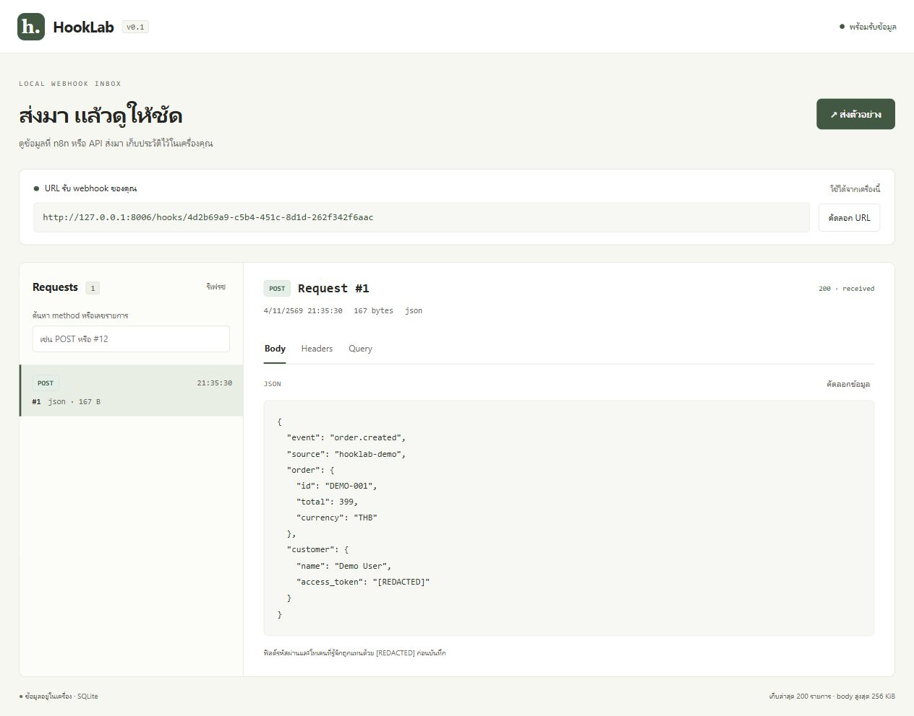

# HookLab

[Source](https://github.com/moses0100/hooklab) · [CI](https://github.com/moses0100/hooklab/actions) · [งานถัดไป](docs/ROADMAP.md)

กล่องรับ webhook ในเครื่อง สำหรับดูว่า n8n หรือ API ส่งข้อมูลอะไรมา

รุ่นแรก: รับ JSON/form-urlencoded, ดู body/headers/query, ปิดบังฟิลด์ความลับที่รู้จัก และเก็บ 200 รายการล่าสุดใน SQLite



## ทำไว้แก้ปัญหาอะไร

ตอนต่อ workflow บางครั้งเราเห็นเพียงว่า request สำเร็จ แต่ไม่เห็น header, query หรือ body ที่ส่งมาจริง HookLab ทำหน้าที่เป็นปลายทางทดสอบ: ส่งมาที่ URL ของ inbox แล้วเปิดดูสิ่งที่รับได้ทันที

ใช้ Node.js HTTP server, `node:sqlite` และหน้าเว็บ JavaScript แบบ ES modules เพื่อฝึก HTTP, validation, SQL และการอัปเดตหน้าจอจากข้อมูลจริง ไม่มีบริการเสียเงินหรือ runtime dependencies

## เริ่มใช้

ใช้ Node.js 24.14 ขึ้นไปในสาย 24 ไม่ต้องติดตั้งแพ็กเกจเพิ่ม

```sh
npm start
```

เปิด http://127.0.0.1:8006 แล้วกด **ส่งตัวอย่าง** หรือคัดลอก URL ไปใส่ HTTP Request node ใน n8n ที่รันจากเครื่องนี้

URL ของ inbox สร้างครั้งแรกและคงเดิมเมื่อ restart ตราบใดที่เก็บไฟล์ฐานข้อมูลเดิมไว้ ข้อมูลที่หน้าเว็บแสดงคือ request จริง ไม่มีรายการจำลองจนกว่าจะกดส่งตัวอย่าง

เปลี่ยนพอร์ตหรือที่เก็บข้อมูลได้บน PowerShell:

```powershell
$env:PORT = '8010'
$env:HOOKLAB_DATA_DIR = 'C:/hooklab-local-data'
npm start
```

ค่าเริ่มต้นใช้พอร์ต 8006 และ `.data/hooklab.sqlite` หากพอร์ตถูกใช้อยู่ ให้เปลี่ยนพอร์ตแทนการปิดโปรแกรมอื่น

## ลองกับ n8n

1. เปิด HookLab แล้วคัดลอก URL จริงจากช่อง URL รับ webhook
2. ใน n8n เพิ่ม **HTTP Request** ตั้ง method เป็น `POST` และวาง URL
3. เปิด Send Body เลือก JSON แล้วใส่ `{"event":"hello","source":"n8n"}`
4. Execute node แล้วกลับมาดูรายการใน HookLab ซึ่งโหลดประวัติใหม่ทุก 2 วินาทีเมื่อเปิดแท็บอยู่
5. เลือก Body, Headers หรือ Query เพื่อตรวจข้อมูล ค้นหาตาม method หรือเลข request ได้

ขั้นตอนนี้สำหรับ n8n ที่รันบนเครื่องเดียวกันตามปกติ `127.0.0.1` จาก Docker หรือเครื่องอื่นหมายถึงคนละ network context; รุ่นนี้ยังไม่มีการตั้งค่าให้ container หรือ n8n Cloud เข้าถึง inbox

อ้างอิง [HTTP Request node ของ n8n](https://docs.n8n.io/integrations/builtin/core-nodes/n8n-nodes-base.httprequest/) และ [SQLite ใน Node.js 24](https://nodejs.org/docs/latest-v24.x/api/sqlite.html) Node.js 24.14.1 ที่ใช้ทดสอบยังแสดง ExperimentalWarning สำหรับ SQLite

## API

| Route | ใช้ทำอะไร |
| --- | --- |
| `GET /api/info` | URL inbox และขีดจำกัด |
| `GET /api/requests` | ประวัติเรียงใหม่ก่อน |
| `GET /api/requests/:id` | รายละเอียดที่ปิดบังข้อมูลแล้ว |
| `GET /api/requests/:id/export` | ดาวน์โหลดรายละเอียดที่ปิดบังแล้วเป็น JSON |
| `/hooks/:inbox-id` | รับ request แล้วตอบ `{"received":true,"id":1}` |

รองรับ body แบบ JSON รวม `+json`, form-urlencoded และ request ที่ไม่มี body จำกัด 256 KiB รับไม่ผ่านจะไม่เพิ่มรายการ: JSON เสียหรือซ้อนลึกเกิน 40 ชั้นตอบ 400, body เกินขนาดตอบ 413 และชนิด body ที่ยังไม่รองรับตอบ 415 ไม่เก็บไฟล์แนบหรือ raw body ในรุ่นแรก

เมื่อเกิน 200 รายการ จะลบรายการเก่าสุดพร้อมบันทึกใหม่ใน transaction เดียวกัน รายการที่หมดอายุจากประวัติจะเรียกดูไม่ได้แล้ว

## ตรวจงาน

```sh
npm run check
npm test
```

ข้อมูลจริงอยู่ใน `.data/` ซึ่งไม่ถูกนำเข้า Git ใช้ตัวอย่างจำลองสำหรับการทดลอง ก่อนส่งข้อมูลให้ทราบว่า redaction ปิดบังเฉพาะชื่อฟิลด์ที่รู้จัก ไม่ใช่การตรวจหาข้อมูลส่วนบุคคลทุกประเภท

ชื่อฟิลด์ที่ตรงกับ authorization, cookie, password, passwd, secret, token, api-key/api_key และ signature จะเป็น `[REDACTED]` ใน JSON ที่ซ้อนกัน, headers, query และ form ก่อนเข้า SQLite ชื่อ อีเมล หรือข้อมูลลับที่แฝงอยู่ในค่าของฟิลด์อื่นอาจยังอยู่ จึงไม่ควรใช้ข้อมูล production จริงในการทดลอง

HookLab เปิดเฉพาะ loopback ไม่มีการยืนยันตัวตน ไม่เปิดรับ webhook จาก n8n Cloud หรือบริการอินเทอร์เน็ตในรุ่นนี้

ไม่มี outgoing HTTP จาก server, analytics หรือการเรียก CDN หน้าเว็บใช้ `textContent` แสดง payload และส่ง CSP ที่อนุญาตสคริปต์จาก origin เดียวกันเท่านั้น

## โครงสร้างและงานถัดไป

```text
src/app.mjs       HTTP routes และ static asset allowlist
src/payload.mjs   จำกัด body, ตรวจชนิดข้อมูล, ปิดบังฟิลด์
src/store.mjs     SQLite, inbox identity และ retention
src/server.mjs    จุดเริ่มต้นแอป
public/           หน้าเว็บ, CSS และ ES module
tests/            HTTP และ persistence tests
```

รุ่นแรกมี checkpoint `checkpoint/first-webhook-inbox` ดูผลทดสอบใน [QA](docs/QA.md) และขอบเขตวันถัดไปใน [Roadmap](docs/ROADMAP.md)

